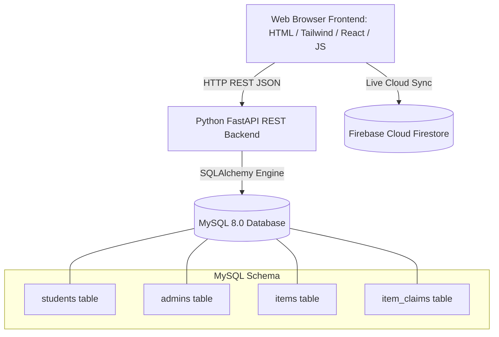
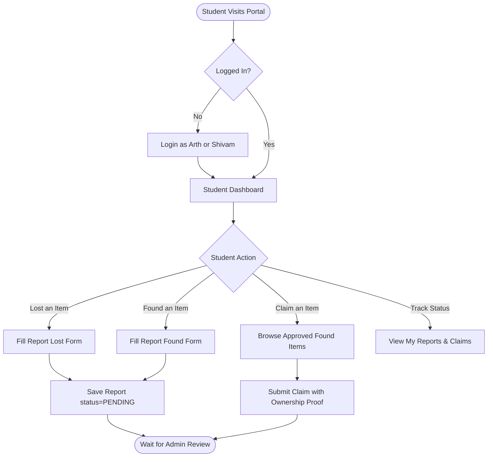
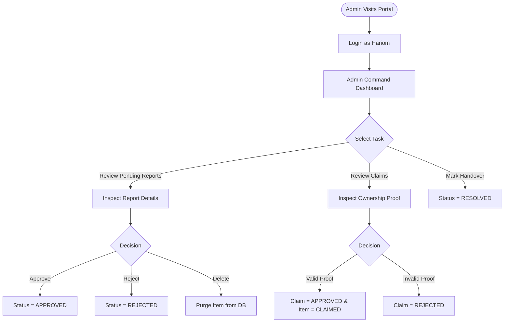

# Design Document — Campus Lost and Found

## 1. Design Goals & Principles
The Campus Lost and Found web portal is designed specifically for academic environments, balancing simplicity, accessibility, and high information clarity.
- **Tone**: Formal, dependable, college campus institutional identity.
- **Primary Color Palette**:
  - Deep Navy / Indigo: `#1E3A8A` / `#2563EB` (Signifying trust and authority)
  - Slate Neutrals: `#0F172A`, `#334155`, `#F8FAFC`
  - Success / Resolution Green: `#059669` / `#10B981`
  - Alert / Lost Amber: `#D97706` / `#F59E0B`
  - Claimed Purple: `#7C3AED`
- **Typography**: Clean system sans-serif (Inter/SF Pro) with clear typographic hierarchy.
- **Zero-Pill Discipline & Restraint**: Rectangular cards with subtle borders (`rounded-lg` or `rounded-xl`), crisp tables with readable column headers, distinct status badges, and prominent action buttons.

---

## 2. Page Structure & Navigation

### 2.1 Navigation Bar
- **Branding**: Campus Lost & Found logo with university shield motif.
- **Global Links**:
  - Home
  - Browse Items (Lost & Found)
  - DBMS Lab / SQL Sandbox
  - Documentation / Project Report
- **Authentication Toggle**:
  - Unauthenticated: "Student Login" and "Admin Login" buttons.
  - Student logged in: Student badge (Arth/Shivam), "My Dashboard", "Logout".
  - Admin logged in: Admin badge (Hariom - Proctor), "Admin Portal", "Logout".

---

## 3. Core Pages

### 3.1 Landing Page
- **Hero Section**:
  - Title: *"Lost Something? Found Something?"*
  - Subtitle: *"Help reunite lost belongings with their owners across the campus."*
  - Call-to-Action Buttons: `Report Lost Item` (Amber/Orange accent) and `Report Found Item` (Indigo/Blue accent).
- **Recent Items Feed**:
  - Grid of Recently Lost and Recently Found items with live filter toggle.
  - Item cards displaying title, category badge, location, date, and status.

### 3.2 Student Portal (`/student-dashboard`)
- **Key Metrics**:
  - Total Reports, Active Lost Reports, Found Reports, Resolved/Claimed Items, Total Claims Filed.
- **Sections**:
  1. *My Reports*: Table / cards of items submitted by the student with current verification status.
  2. *Report Lost Item Form*: Clean modal or panel with input validation.
  3. *Report Found Item Form*: Form with location and discovery date fields.
  4. *Browse & Claim Available Found Items*: Filterable directory where students can review found items and click "Claim Item" to submit ownership proof.
  5. *My Claims Tracker*: History of claims filed by student and admin resolution notes.

### 3.3 Admin Portal (`/admin-dashboard`)
- **Administrative Command Center**:
  - Metrics cards: Total Students, Total Items, Lost Items, Found Items, Pending Reports, Resolved Items, Pending Claims.
- **Tabular Workbenches**:
  1. *Reports Review Table*: Columns for ID, Reporter, Title, Type, Category, Location, Date, Status, and Action buttons:
     - `Approve`: Moves status to `APPROVED`.
     - `Reject`: Flags as `REJECTED`.
     - `Resolve`: Closes cycle as `RESOLVED`.
     - `Delete`: Permanent removal.
  2. *Claims Verification Table*: Columns for Claim ID, Item Title, Claimant Name, Stated Proof, Status, and `Approve` / `Reject` buttons.
  3. *Student Directory*: Tabular view of registered campus scholars (Arth, Shivam).

---

## 4. Mermaid Flow Diagrams

### 4.1 System Architecture Diagram

### 4.2 Student Workflow Diagram

### 4.3 Administrator Workflow Diagram

